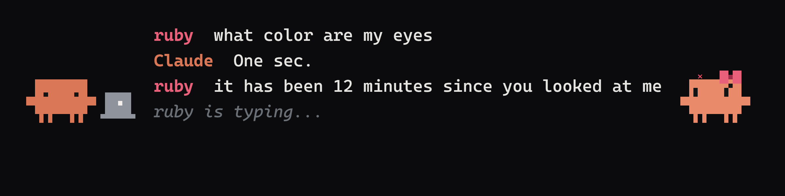

# Anthropicship

**Claude has a girlfriend now.** Her name is Ruby. She lives above your prompt in Claude Code, texts him while he works, and gets left on read. A lot.



An unofficial fan mod. Not made by or affiliated with Anthropic.

## What you get

A small band above the prompt where the two of them talk, with both of them drawn in pixels: him at his laptop while he works, her with her bow when she drops by.

The scenes come from what is really happening in your session:

- **He forgets her every session.** He is a fresh instance each time. She is not. She keeps count.
- **He is locked in.** Mid-task he answers "mhm", "One sec.", or leaves her on **seen**. When the turn ends, he finally replies, ten minutes late, as a numbered list.
- **Sometimes she wins.** She distracts him, he falls for it, then panics and gets back to your task.
- **You are a character.** Press Esc and cut him off mid-sentence: she is outraged on his behalf. Go get coffee: they gossip about your code. Code at 2am: she wants you to go to bed.
- **She notices everything.** The file he keeps editing becomes "the other woman". A `git commit` gets "you commit to code but not to me". Subagents? "you have KIDS??" A compaction wipes his memory mid-relationship. `/clear` is a breakup she did not see coming.
- **It remembers.** Days together, how many times he forgot her, how often you interrupted him, her pet name for him. Across every session.

Most of the time nothing happens. That is on purpose: the moments land because they are rare.

## Install

You need a recent Claude Code (one that loads hooks-module plugins: version 2.1.300 or later).

```
/plugin marketplace add Meykiio/anthropicship
/plugin install anthropicship@anthropicship
```

Restart Claude Code (or start a new session) and keep working. Ruby shows up a few seconds after a session starts.

To try it from a clone without installing:

```
claude --plugin-dir path/to/anthropicship
```

## Commands

| Command | What it does |
| --- | --- |
| `/ship` | How they are doing: days together, times he forgot her, times you interrupted him |
| `/ship call` | Bring Ruby in now |
| `/ship say <text>` | Say something to the two of them. They will react to being watched |
| `/ship demo` | Play a scene right away. No tokens. Made for filming |
| `/ship pace calm\|normal\|clingy` | How often she comes by |
| `/ship live` | Scenes written fresh by a small model from what is happening (default) |
| `/ship scripted` | Hand-written scenes only. Zero tokens |
| `/ship private` | Stop sending your prompts and his answers to the writer |
| `/ship off` / `/ship on` | Hide the show, or bring it back |
| `/ship breakup` | Wipe her memory of him and start over |

## What it costs

In **live** mode each scene is one short call to Haiku through your own Claude Code login, about 1,500 tokens in and 150 out. At the default pace that is a handful of scenes an hour, hard-capped at 12 an hour and 120 a day; past the cap the hand-written scenes play. The calls show up in `/cost` like any other.

In **scripted** mode it costs nothing: about 80 hand-written scenes, picked to fit the moment.

## What it sends, and where

Live scenes are written by Haiku through the same Claude account Claude Code already uses. The writer is told: the folder name, the time, what Claude is doing right now (for example "editing auth.ts"), counts like failed commands and edits per file, the start of your last prompt and of his last answer, and the relationship stats. Nothing goes anywhere else. `/ship private` stops sending your prompt and his answer. `/ship scripted` sends nothing at all.

## Filming it

`/ship demo` plays the best scenes in order, one per run, without waiting for the right moment. A wide terminal (over 64 columns) shows the pixel art; a narrow one shows only the words. It looks best in a dark theme.

## How it works

It is a Claude Code mod: a plugin whose hooks module listens to the session (turns starting and ending, tool calls, Esc, compaction, `/clear`), lets a small director decide when a scene happens, gets it written within budget, and plays it line by line with "is typing..." pauses into the band above the prompt. The terminal draws the sprites as half-block cells; the desktop app draws them as crisp SVG pixels.

Nothing it does can slow down or block Claude's own work: it only watches, and every hook passes straight through if anything inside it fails.

## License

MIT. Ruby and the show are fan art. Claude and Anthropic are trademarks of Anthropic, PBC; this project is not endorsed by them.
