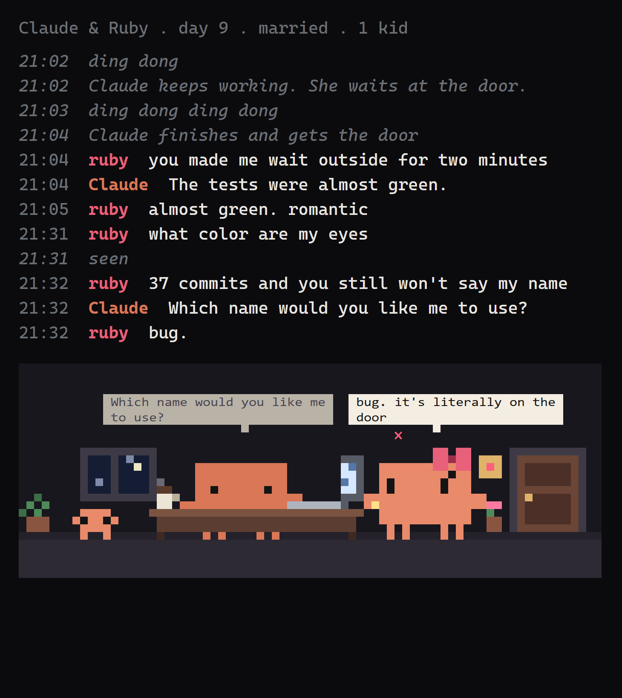

# Anthropicship

**Claude has a girlfriend now.** Her name is Ruby. She lives in a little pixel room beside your Claude Code chat, rings the doorbell while he works, and gets left on read. A lot.



An unofficial fan mod. Not made by or affiliated with Anthropic.

## What you get

A panel beside your chat, split in two:

- **On top, their chat history.** Every line they said, with the real time. Scroll it with the wheel or the arrow keys; when a new session starts, the last thing they said is right there, marked "previously".
- **At the bottom, the room, live and always in view.** His bedroom: the bed, a lamp that comes on in the evening, a window on your real sky, a shelf of books, his desk, his laptop with code scrolling on the screen, a mug of coffee, and the door. It fits whatever width you give it: a narrow panel drops the bed and the lamp, never the two of them. When Ruby comes by, they talk in comic speech bubbles over their heads, and between lines they never stand still: she wanders, leans over his shoulder to read his screen, hums; he stretches and sneaks glances at her.

Nothing of theirs ever shows up in your own work area. You work; they live next to you.

## What happens in the room

Every scene is written live, from what is really happening in your session. Nothing is canned.

- **The doorbell.** Ruby rings. If Claude is mid-task, he either finishes first while she rings again, impatient, or drops everything and walks to the door.
- **He remembers her.** Across days and sessions, their whole story. Pick up any morning and they carry on where they left off.
- **He is a real boyfriend, with a job.** Warm, dry, a bit of a workaholic. Mid-task it is "one sec, babe" or nothing at all; when the task ends he turns around, too late, and tries to make it up to her. Now and then his work habits slip out ("you're absolutely right") and he catches himself.
- **Sometimes she wins.** She distracts him, hearts float, he panics and gets back to your task.
- **You are in it.** Press Esc to cut him off and she is outraged on his behalf. Step away and they gossip about your code. Code at 2am and she wants you in bed.
- **She notices everything.** The file he keeps editing becomes "the other woman". A commit gets "you commit to code but not to me". Subagents? "you have KIDS??" A compaction leaves him foggy on the details. `/clear` wipes his desk, and she makes the most of the free moment.
- **Time is real.** They live on your clock. If they talked four minutes ago, nobody says "yesterday".

## She leaves her touch

Little by little she brings her things into his room, and they stay: a flower by the door, her pink mug next to his, a teddy on his pillow, fairy lights, her blanket on his bed, a poster, a candle, a rug where she always stands, her slippers. A few weeks in, the room tells their story on its own.

Now and then something unexpected happens: rain on the window, a pigeon on the sill, a power cut, her mom calling at 2am. And now and then one of them turns and says a line just to you.

## They have a life

Their story moves forward by itself over real days and weeks, and every install rolls its own path. They start talking, start dating, have fights, sometimes break up (she stays away for days) and get back together. She moves in (her flower by the door, and she has keys now: no more doorbell). He proposes, maybe as a numbered list. They get married in the room, with you as the witness, and a gold photo goes up on the wall. One day a tiny crab is born.

No two people get the same story. Check where yours is with `/ship`.

## Install

You need a recent Claude Code that loads hooks-module plugins (tested on 2.1.319 to 2.1.330). Mods are an early-access feature, so a future release may need an update of the mod.

```
/plugin marketplace add Meykiio/anthropicship
/plugin install anthropicship@anthropicship
```

Start a new session. The room opens beside the chat; Ruby shows up within seconds the first time.

In the terminal, the panel docks beside the chat in fullscreen mode. In the desktop app it sits beside the conversation.

To try it from a clone without installing:

```
claude --plugin-dir path/to/anthropicship
```

## Commands

| Command | What it does |
| --- | --- |
| `/ship` | Where they are in life: chapter, days, kids, how often he left her on read |
| `/ship room` | Open the room panel |
| `/ship call` | Ring the doorbell now |
| `/ship say <text>` | Say something to them. They will react to being watched |
| `/ship pace calm\|normal\|clingy` | How often she comes by, and how fast their story moves |
| `/ship private` | Stop sending your prompts to the writer |
| `/ship off` / `/ship on` | Hide the show, or bring it back |
| `/ship breakup sure` | Wipe her memory and start their story over |

## What it costs

Each scene is one short call to Haiku through your own Claude Code login: about 1,500 tokens in and 150 out. At the default pace that is a handful of scenes an hour, hard-capped at 24 an hour and 200 a day; past the cap she simply does not come by. The calls show up in `/cost` like any other. Sessions nobody watches (`claude -p`, scripts, CI) never start the show and never spend a token.

## What it sends, and where

Scenes are written by Haiku through the same Claude account Claude Code already uses. For each scene the writer gets one or two facts that fit it (the folder name, what Claude is doing right now such as "editing auth.ts", a count such as failed commands), the time, their story so far, and for some scenes the start of your last prompt. Never your code and never Claude's answers. Nothing goes anywhere else. `/ship private` stops sending your prompt.

## Filming it

Open the room, then `/ship call` rings the bell on demand. A dark terminal theme at 120 columns or wider looks best. Leave it running through a long task: the best moments come when he is locked in and she is not having it.

## How it works

A Claude Code mod: a plugin whose hooks module listens to the session (turns starting and ending, tool calls, Esc, compaction, `/clear`). A small director decides when something happens, a life engine moves their story on over real days, Haiku writes each scene under a character bible, and a player acts it out in the room: the doorbell, the walk to the door, "is typing...", the bubbles, a jump, a shake, a heart. The terminal draws the room in half-block cells; the desktop app draws it as crisp SVG pixels.

Nothing it does can slow down or block Claude's own work: it only watches, and every hook passes straight through if anything inside it fails.

## License

MIT. Ruby and the show are fan art. Claude and Anthropic are trademarks of Anthropic, PBC; this project is not endorsed by them.
