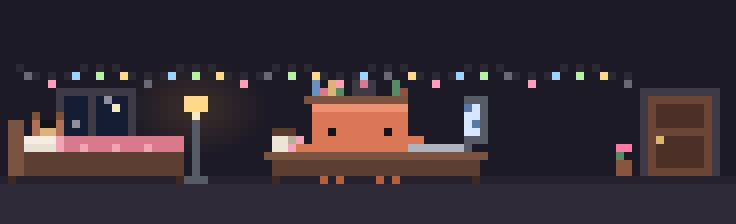

<div align="center">

# Anthropicship

### Claude has a girlfriend now.

**A tiny pixel room lives next to your Claude Code chat. Claude works. Ruby rings the doorbell.**<br>
**Over the next few weeks, they build a life together, right next to your code.**



[](LICENSE)
[](#install-in-30-seconds)
[](#the-room)

[Install](#install-in-30-seconds) . [What happens](#what-happens) . [Their life](#their-life) . [Share yours](#share-your-story)

</div>

---

You ask Claude to fix a bug. Halfway through, the doorbell rings.

Sometimes he keeps typing while she rings again, and again, and finally lets herself in. Sometimes he drops everything, mid-task, and walks to the door. Then they talk, in little speech bubbles, while you watch from the side of your screen and pretend you are not watching.

**It's a soap opera that runs on your coding session.** Every line is written live from what's really happening: how long he's been stuck, the late hour, the commit he just made, the moment you cut him off with Esc. No two people get the same story.

## What happens

- **The doorbell.** She comes by on her own. Mid-task he has to choose: finish first, or let her in. You'll catch yourself rooting for one.
- **He's a workaholic. She's not having it.** "two minutes, babe" for an hour. She times it. She reads over his shoulder. Sometimes she wins, the hearts come out, and he panics back to your task.
- **She knows nothing about code** and doesn't want to. The few words she picks up from him, she uses proudly and slightly wrong.
- **You're in it.** Press Esc mid-answer and she's outraged on his behalf. Step away and they gossip about you. Code at 2am and she wants you both in bed.
- **They remember.** Promises, plans, her sister's visit, the pasta he still owes her. Open your laptop tomorrow and the story picks up where it left off, with a "previously" at the top.
- **Now and then, something happens.** Rain on the window. A pigeon on the sill. The power goes out. Her mom calls at 1:40am.
- **Now and then, one of them turns to you** and says something the other can't hear.

## Their life

Their relationship moves on by itself, on real days. Talking. Dating. A fight about nothing. A breakup that keeps her away for days. Making up. Moving in (she has keys now, no more doorbell). A proposal. A wedding in the room, with you as the witness. One day, a tiny crab.

**Everyone's path is different.** Some couples break up in week one. Some are married by week four. Type `/ship` to see where yours are.

## The room

His bedroom, drawn pixel by pixel next to your chat: the bed, a lamp that comes on in the evening, a window showing your real sky, his desk, his laptop with code scrolling while he types, a mug of coffee, the door.

**She leaves her touch.** Little by little her things move in, and stay: a flower by the door, her mug next to his, a teddy on his pillow, fairy lights, her blanket on his bed, a candle, her slippers. A few weeks in, the room tells their story on its own.

The panel shows **their chat history on top** (scroll back through everything they said, with real times) and **the live room pinned at the bottom**. Nothing of theirs ever appears in your own chat: you work, they live next door.

## Install in 30 seconds

Inside Claude Code:

```
/plugin marketplace add Meykiio/anthropicship
/plugin install anthropicship@anthropicship
```

Restart Claude Code. The room opens beside your chat and Ruby shows up within seconds the first time. If the panel doesn't open, type `/ship room`.

Needs a recent Claude Code with hooks-module plugins (tested on 2.1.319 to 2.1.330). In the terminal, the panel docks beside the chat in fullscreen mode; in the desktop app it sits beside the conversation.

## Commands

| Command | What it does |
| --- | --- |
| `/ship` | Where they are in life: chapter, days together, kids |
| `/ship room` | Open the room |
| `/ship call` | Ring the doorbell now (great for filming) |
| `/ship say <text>` | Say something to them. They will react to being watched |
| `/ship pace calm\|normal\|clingy` | How often she comes by, and how fast their story moves |
| `/ship private` | Stop sending your prompts to the writer |
| `/ship off` / `/ship on` | Hide the show, or bring it back |
| `/ship breakup sure` | Wipe her memory and start their story over |

## Share your story

Film the moment the doorbell rings mid-deploy. Screenshot the proposal. Post the day the crab was born.

Tag it **#ClaudeAndRuby** so people can follow other couples. Say what day you're on and what chapter they're in: no two stories match.

If they made you smile, a star on the repo helps other people find them.

## What it costs

Each scene is one short call to Haiku through your own Claude Code login, about 1,500 tokens in and 150 out. A few scenes an hour at the default pace, hard-capped at 24 an hour and 200 a day; past the cap she simply doesn't come by. All the movement between lines (walking, glances, the lamp, the rain) costs nothing. Sessions nobody watches (`claude -p`, scripts, CI) never start the show and never spend a token.

## Privacy

Scenes are written by Haiku through the same Claude account Claude Code already uses. For each scene the writer gets one or two small facts (the folder name, what he's doing right now such as "editing auth.ts", a count like failed commands), the time, their story so far, and for some scenes the start of your last prompt. Never your code and never Claude's answers. Nothing goes anywhere else. `/ship private` stops sending your prompt.

## How it works

A Claude Code mod: a plugin whose hooks module watches the session (turns, tool calls, Esc, compaction, `/clear`). A director decides when something happens, a story engine moves their life on over real days, Haiku writes each scene under a character bible, and a player acts it out in the room: the doorbell, the walk to the door, the typing dots, the bubbles, a jump, a shake, a heart. The terminal draws the room in half-block cells; the desktop app in crisp SVG pixels.

Nothing it does can slow down or block Claude's real work: it only watches, and every hook steps aside if anything inside it fails.

Want to hack on it? See [`CLAUDE.md`](CLAUDE.md) for the commands; `claude plugin test .` runs the tests.

## License

MIT. Ruby and the show are fan art. Claude and Anthropic are trademarks of Anthropic, PBC; this is an unofficial fan project, not made or endorsed by them.
